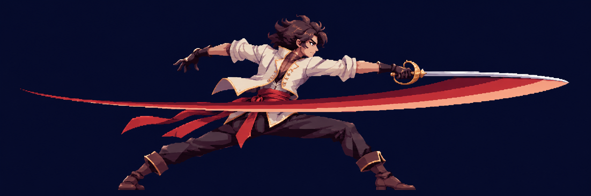
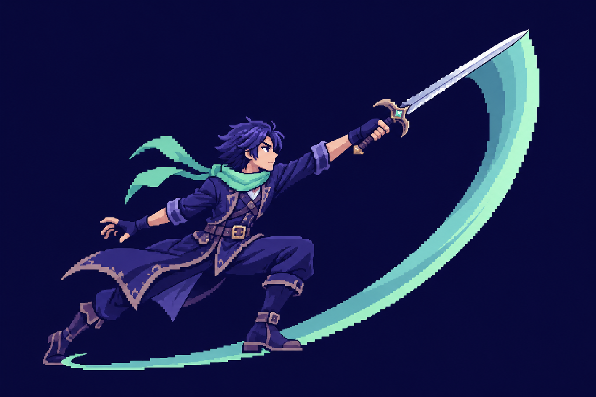
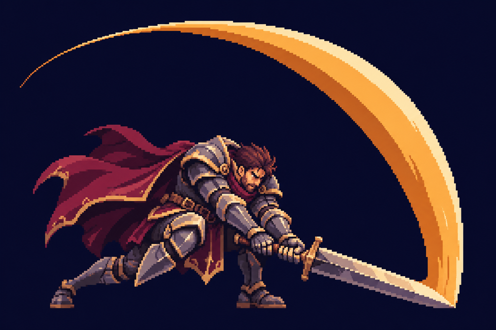
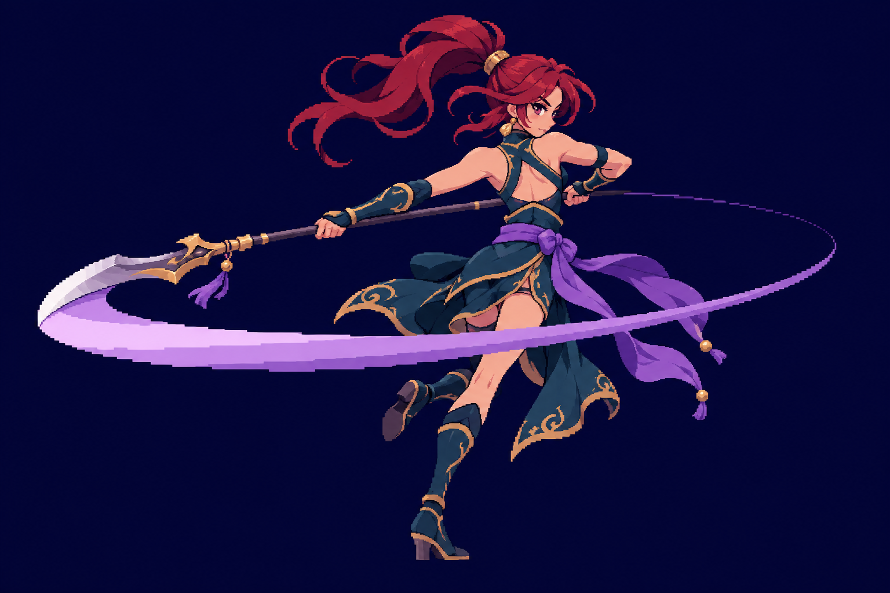

# 攻击拖影参考图

先看当前角色不带特效的动作，找出命中帧的刀刃和它刚扫过的位置。选挥动平面最接近的一张图，观察前缘如何接刃、旧位置如何收细、人物挡住了哪一段。角色姿势、颜色和弧线跨度都按当前素材决定。直刺可以保留窄直轨迹。

## 横斩

腰部转动带剑横扫，侧视下呈宽而浅的弧。沿红色细尾向右看，拖影逐渐加宽，前缘接到银色刀刃外段，握手仍清楚可见。

## 上挑

剑已经举到右上方，先前的低位由脚边细尾交代。青色外缘从低到高连续转弯，剑、手与前臂都留在弧的开口处。

## 下劈

人物屈膝压低重心，剑落到右下方。金色细尾留在高处，宽处随剑刃下落。对照实际画布检查弧顶和落剑处的留白。

## 回旋

人物转身时，远侧的细尾被躯干遮住，近侧的宽弧从腿前经过，接上左侧刀尖。画面中这一前一后的遮挡交代了挥动的深度。

回到实际动画，比较加速、命中和收招帧，再按原速播放，确认拖影与刀锋同时到位。
